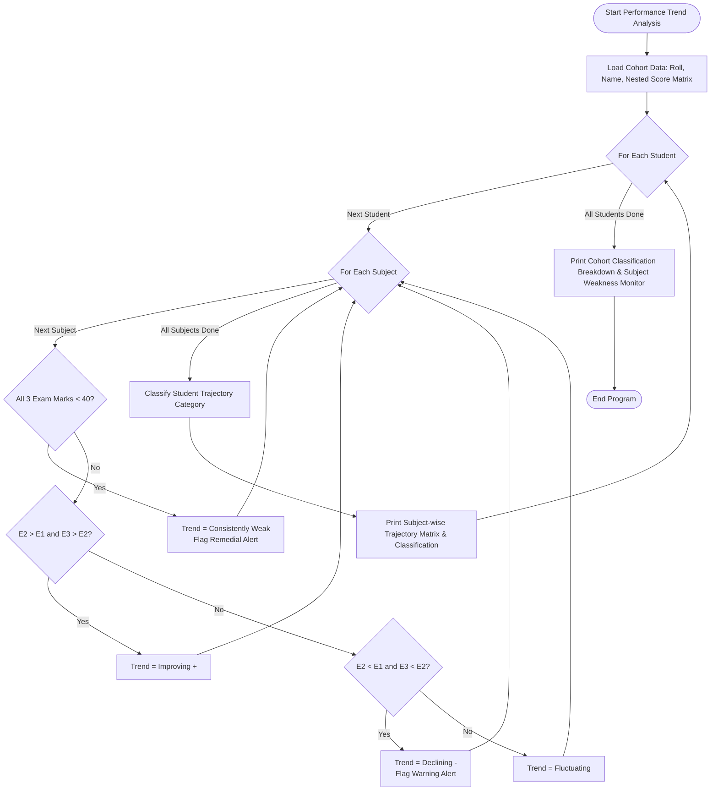

# Case Study 17: Student Performance Trend Analysis

**Course**: Python Programming (Activity-Based Learning - ABL)  
**Institution**: Dr. RVR NRI Institute of Technology  
**Student Name**: Shukur  
**Roll Number**: 24NR1A0501  
**Branch**: Computer Science & Engineering (CSE)  
**Section**: CSE-A  

---

## 1. Problem Statement
Academic departments conduct progressive internal examinations (e.g., Assessment 1, Assessment 2, Assessment 3) across multiple core technical subjects. Single examination marks provide only a static snapshot of student ability and fail to capture learning trajectory, momentum, or academic decay. A comprehensive diagnostic system is required to track marks longitudinally across all assessments, calculate step-wise score differentials, identify subject-specific persistent weakness (scores $< 40$ in all exams), determine improvement/decline trends, and classify students into actionable pedagogical cohorts (Outstanding Scholar, Consistent Improver, Steady Performer, Academic Warning, and Remedial Support).

---

## 2. Objectives
1. Model multi-exam, multi-subject academic scores using 3D/nested list structures.
2. Calculate step-by-step differentials across sequential examination cycles for each subject.
3. Automatically flag subjects exhibiting persistent failure or chronic weakness ($< 40$ across all assessments).
4. Classify student learning trajectories using multi-variable academic rule engines.
5. Provide institutional summaries identifying systemic subjects requiring curricular intervention.

---

## 3. Assumptions
1. Each examination is scored out of a maximum of 100 marks; the statutory passing mark is 40.
2. Assessments are administered chronologically (Assessment 1 $\rightarrow$ Assessment 2 $\rightarrow$ Assessment 3).
3. Student data is stored as a tuple `(roll_number, student_name, score_matrix)`, where `score_matrix` is a 2D list indexed by `[exam_index][subject_index]`.
4. No external numerical libraries (e.g., NumPy) are utilized; all matrix reductions are computed using pure nested iteration.

---

## 4. Step-by-Step Algorithm

```
Step 1: Define lists of curricular subjects and assessment names.
Step 2: Initialize student cohort data as a list of tuples containing nested lists of marks.
Step 3: For each student in the cohort:
    Step 3.1: Calculate individual exam averages across subjects.
    Step 3.2: Compute overall aggregate average and net trajectory shift (Exam 3 Avg - Exam 1 Avg).
    Step 3.3: For each subject:
              - Extract the historical score vector [Exam 1, Exam 2, Exam 3].
              - If all scores in the subject < 40: Trend = "Consistently Weak".
              - Else if Exam 2 > Exam 1 and Exam 3 > Exam 2: Trend = "Improving (+)".
              - Else if Exam 2 < Exam 1 and Exam 3 < Exam 2: Trend = "Declining (-)".
              - Else: Trend = "Fluctuating".
              - Compute net shift = Exam 3 - Exam 1.
    Step 3.4: Classify the student:
              - If any subject is "Consistently Weak": Category = "Remedial Support".
              - Else if Overall Avg >= 80 and Net Shift >= 0: Category = "Outstanding Scholar".
              - Else if Net Shift >= 8.0: Category = "Consistent Improver".
              - Else if Net Shift <= -10.0 or has declining subjects: Category = "Academic Warning".
              - Else: Category = "Steady Performer".
Step 4: Accumulate classification distribution and identify subject-wide weakness counts.
Step 5: Output detailed student trajectory sheets and batch distribution summary.
```

---

## 5. Flowchart



---

## 6. Pseudocode

```text
ALGORITHM PerformanceTrendAnalysis:
    INPUT: List students_data, List subjects, List exam_names
    OUTPUT: Student trend matrices, classification reports, subject monitors

    FOR EACH student IN students_data DO:
        roll_no, name, score_matrix = student
        exam_averages = []
        FOR exam_idx FROM 0 TO LENGTH(exam_names)-1 DO:
            sum_val = 0
            FOR subj_idx FROM 0 TO LENGTH(subjects)-1 DO:
                sum_val = sum_val + score_matrix[exam_idx][subj_idx]
            END FOR
            exam_averages.APPEND(sum_val / LENGTH(subjects))
        END FOR

        overall_avg = AVERAGE(exam_averages)
        net_shift = exam_averages[LAST] - exam_averages[FIRST]

        has_weak = FALSE
        has_declining = FALSE

        FOR subj_idx FROM 0 TO LENGTH(subjects)-1 DO:
            scores = EXTRACT_COLUMN(score_matrix, subj_idx)
            IF ALL(scores < 40) THEN:
                trend = "Consistently Weak"
                has_weak = TRUE
            ELSE IF IS_STRICTLY_INCREASING(scores) THEN:
                trend = "Improving (+)"
            ELSE IF IS_STRICTLY_DECREASING(scores) THEN:
                trend = "Declining (-)"
                has_declining = TRUE
            ELSE:
                trend = "Fluctuating"
            END IF
        END FOR

        // Rule-based classification
        category = CLASSIFY(overall_avg, net_shift, has_weak, has_declining)
        PRINT student scorecard, trends, and category
    END FOR

    PRINT cohort distributions and subject weakness counters
END ALGORITHM
```

---

## 7. Python Source Code Listing
The complete implementation is available in [`performance_trend.py`](file:///e:/shukur%20python%20activity%20based%20learning/case_study_17_performance_trend/performance_trend.py).

---

## 8. Test Cases & Verification

| Student Roll & Name | Exam 1 / 2 / 3 Averages | Subject Trends | Net Shift | Expected Category | Verification Status |
|:---:|:---:|:---:|:---:|:---:|:---:|
| **24NR1A0501 - Shukur** | 81.2 / 86.8 / 91.8 | All Subjects Improving (+) | +10.50 | Outstanding Scholar | **PASS** |
| **24NR1A0502 - Aarav Sharma** | 68.8 / 63.8 / 56.2 | All Subjects Declining (-) | -12.50 | Academic Warning | **PASS** |
| **24NR1A0503 - Bhavya Sri** | 33.8 / 34.2 / 35.8 | All Subjects Consistently Weak | +2.00 | Remedial Support | **PASS** |
| **24NR1A0504 - Charan Teja** | 58.8 / 68.8 / 77.2 | Rapid Improvement in All | +18.50 | Consistent Improver | **PASS** |
| **24NR1A0505 - Divya Lakshmi** | 77.8 / 78.2 / 78.8 | Steady across exams | +1.00 | Steady Performer | **PASS** |

---

## 9. Program Execution Output
```text
================================================================================
                LONGITUDINAL STUDENT PERFORMANCE TREND ANALYSIS                 
================================================================================
Examinations Tracked : Assessment 1, Assessment 2, Assessment 3
Subjects Evaluated   : Mathematics, Python Prog., Applied Physics, Data Structures

--- Student: Shukur (Roll: 24NR1A0501) ---
Subject            Assessment 1 Assessment 2 Assessment 3 Net Shift    Trend             
---------------------------------------------------------------------------
Mathematics         82.0       88.0       92.0      +10.0        Improving (+)     
Python Prog.        85.0       90.0       95.0      +10.0        Improving (+)     
Applied Physics     78.0       84.0       89.0      +11.0        Improving (+)     
Data Structures     80.0       85.0       91.0      +11.0        Improving (+)     
---------------------------------------------------------------------------
Exam Averages : Assessment 1: 81.2 | Assessment 2: 86.8 | Assessment 3: 91.8
Overall Avg   : 86.58 | Net Trajectory: +10.50
Classification: >>> OUTSTANDING SCHOLAR <<<

--- Student: Aarav Sharma (Roll: 24NR1A0502) ---
Subject            Assessment 1 Assessment 2 Assessment 3 Net Shift    Trend             
---------------------------------------------------------------------------
Mathematics         70.0       68.0       62.0       -8.0        Declining (-)     
Python Prog.        72.0       65.0       58.0      -14.0        Declining (-)     
Applied Physics     68.0       62.0       55.0      -13.0        Declining (-)     
Data Structures     65.0       60.0       50.0      -15.0        Declining (-)     
---------------------------------------------------------------------------
Exam Averages : Assessment 1: 68.8 | Assessment 2: 63.8 | Assessment 3: 56.2
Overall Avg   : 62.92 | Net Trajectory: -12.50
Classification: >>> ACADEMIC WARNING <<<

--- Student: Bhavya Sri (Roll: 24NR1A0503) ---
Subject            Assessment 1 Assessment 2 Assessment 3 Net Shift    Trend             
---------------------------------------------------------------------------
Mathematics         35.0       36.0       38.0       +3.0        Consistently Weak 
Python Prog.        38.0       35.0       36.0       -2.0        Consistently Weak 
Applied Physics     32.0       34.0       35.0       +3.0        Consistently Weak 
Data Structures     30.0       32.0       34.0       +4.0        Consistently Weak 
---------------------------------------------------------------------------
Exam Averages : Assessment 1: 33.8 | Assessment 2: 34.2 | Assessment 3: 35.8
Overall Avg   : 34.58 | Net Trajectory: +2.00
Classification: >>> REMEDIAL SUPPORT <<<

================================================================================
                BATCH PERFORMANCE SUMMARY & COHORT DISTRIBUTION                 
================================================================================
Classification Category        Student Count   Percentage     
------------------------------------------------------------
Outstanding Scholar            1               20.0          %
Consistent Improver            1               20.0          %
Steady Performer               1               20.0          %
Academic Warning               1               20.0          %
Remedial Support               1               20.0          %
------------------------------------------------------------
```

---

## 10. Conclusion & Key Learnings
1. **Multi-Dimensional Analysis**: Analyzing trends across multiple examination cycles reveals academic decay early, allowing timely faculty intervention before final semester exams.
2. **Matrix Traversals**: Implemented multi-level row and column traversals across 3D nested lists using native Python primitives.
3. **Actionable Classification**: The rule-based classification cleanly separates exceptional performers from those needing emergency remediation.

