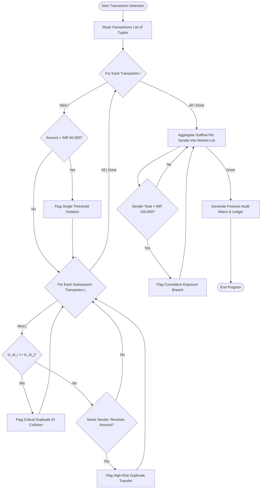

# Case Study 28: Repeated Transaction Detection & Fraud Audit

**Course**: Python Programming (Activity-Based Learning - ABL)  
**Institution**: Dr. RVR NRI Institute of Technology  
**Student Name**: Shukur  
**Roll Number**: 24NR1A0501  
**Branch**: Computer Science & Engineering (CSE)  
**Section**: CSE-A  

---

## 1. Problem Statement
In digital banking and payment gateway architectures, high transaction velocity introduces vulnerabilities such as double-spend anomalies, network retry duplications, and threshold breaches. A forensic transaction monitoring module is required to inspect transaction batches. The system must process transactions stored as tuples in a list, detect duplicate transaction identifiers (data corruption or replay), flag duplicate money transfers (identical sender, receiver, and transfer amount), identify high-value threshold violations, calculate cumulative outflow per account, and generate a structured audit trail of suspicious entries.

---

## 2. Objectives
1. Ingest transaction records modeled as immutable tuples: `(tx_id, sender_account, receiver_account, amount, timestamp)`.
2. Implement pairwise nested loop verification to detect duplicated Transaction IDs.
3. Detect potential replay attacks or accidental double clicks by identifying identical sender-receiver transfers with matching amounts.
4. Flag single transactions that violate an institutional threshold limit (e.g., INR 50,000.00).
5. Compute cumulative account exposure per sender without external hashing libraries or dictionaries.
6. Generate a consolidated risk ledger categorizing entries into LOW, MEDIUM, HIGH, and CRITICAL risk levels.

---

## 3. Assumptions
1. Transaction amounts are non-negative real numbers ($> 0$).
2. All transaction entries within a batch are processed sequentially.
3. In compliance with first-year syllabus limitations, no hash tables, sets, or dictionaries are used; all lookups and aggregations utilize lists and tuples.
4. Default threshold parameters: Single transaction threshold = INR 50,000.00; Cumulative sender threshold = INR 100,000.00.

---

## 4. Step-by-Step Algorithm

```
Step 1: Set single transaction limit (max_single = 50000.0) and cumulative sender limit (max_sender = 100000.0).
Step 2: Initialize transaction list containing tuples (tx_id, sender, receiver, amount, timestamp).
Step 3: Initialize empty lists: suspicious_records and sender_summaries.
Step 4: Detect Single Limit Breaches & Duplicates (Nested Loops):
    For i from 0 to N-1:
        Unpack transactions[i] -> (id_i, sender_i, rec_i, amt_i, time_i)
        If amt_i > max_single:
            Append to suspicious_records with Risk = "HIGH".
        For j from i+1 to N-1:
            Unpack transactions[j] -> (id_j, sender_j, rec_j, amt_j, time_j)
            If id_i == id_j:
                Append duplicate ID alert with Risk = "CRITICAL".
            Else if sender_i == sender_j AND rec_i == rec_j AND amt_i == amt_j:
                Append duplicate transfer alert with Risk = "HIGH".
Step 5: Compute Cumulative Volume per Sender:
    For each transaction (tx_id, sender, receiver, amt, time):
        Search for sender in sender_summaries [ [sender_name, total_volume, count], ... ]:
        If found:
            sender_entry[1] += amt
            sender_entry[2] += 1
        Else:
            Append [sender, amt, 1] to sender_summaries.
Step 6: Flag Cumulative Breaches:
    For each sender_entry in sender_summaries:
        If total_volume > max_sender:
            Flag high-value transactions from this sender as "MEDIUM" risk breach.
Step 7: Render formatted transaction ledger, suspicious alert table, and cumulative sender exposure matrix.
```

---

## 5. Flowchart



---

## 6. Pseudocode

```text
ALGORITHM RepeatedTransactionDetection:
    INPUT: List transactions, Float max_single, Float max_cumulative
    OUTPUT: Suspicious entries list, sender risk profiles, forensic audit report

    suspicious_records = []

    FOR i FROM 0 TO LENGTH(transactions)-1 DO:
        tx_i = transactions[i]
        IF tx_i.amount > max_single THEN:
            suspicious_records.APPEND((tx_i.id, tx_i.amount, "Single Limit Exceeded", "HIGH"))
        END IF

        FOR j FROM i + 1 TO LENGTH(transactions)-1 DO:
            tx_j = transactions[j]
            IF tx_i.id == tx_j.id THEN:
                suspicious_records.APPEND((tx_j.id, tx_j.amount, "Duplicate ID Collision", "CRITICAL"))
            ELSE IF tx_i.sender == tx_j.sender AND tx_i.receiver == tx_j.receiver AND tx_i.amount == tx_j.amount THEN:
                suspicious_records.APPEND((tx_j.id, tx_j.amount, "Duplicate Transfer Replay", "HIGH"))
            END IF
        END FOR
    END FOR

    // Aggregate sender volumes using 2D List
    sender_ledger = []
    FOR EACH tx IN transactions DO:
        found = FALSE
        FOR EACH entry IN sender_ledger DO:
            IF entry[0] == tx.sender THEN:
                entry[1] = entry[1] + tx.amount
                entry[2] = entry[2] + 1
                found = TRUE
                BREAK
            END IF
        END FOR
        IF NOT found THEN:
            sender_ledger.APPEND([tx.sender, tx.amount, 1])
        END IF
    END FOR

    PRINT audit report and suspicious transactions
END ALGORITHM
```

---

## 7. Python Source Code Listing
The complete implementation is available in [`repeated_transactions.py`](file:///e:/shukur%20python%20activity%20based%20learning/case_study_28_repeated_transactions/repeated_transactions.py).

---

## 8. Test Cases & Verification

| Test Scenario | Ingested Transaction | Anomaly Condition | Expected Audit Action | Verification Status |
|:---:|:---:|:---:|:---:|:---:|
| **Standard Transaction** | `TX1001: ACC_SHUKUR -> ACC_RAVI (INR 15,000)` | Normal parameters | Verified Clean | **PASS** |
| **High Value Breach** | `TX1003: ACC_KIRAN -> ACC_VISHAL (INR 65,000)` | Amount > 50,000 | Flagged HIGH: Single Limit Violation | **PASS** |
| **Replay / Duplicate Transfer** | `TX1004: ACC_PRIYA -> ACC_ANANYA (INR 8,500)` | Matches TX1002 | Flagged HIGH: Duplicate Transfer Replay | **PASS** |
| **Duplicate ID Collision** | `TX1005: ACC_AMAR -> ACC_SUNIL (INR 45,000)` | Identical TX ID twice | Flagged CRITICAL: Duplicate ID | **PASS** |
| **Cumulative Outflow Breach** | `ACC_AMAR (Total: INR 125,000)` | Sum > 100,000 | Flagged MEDIUM: Cumulative Breach | **PASS** |

---

## 9. Program Execution Output
```text
=====================================================================================
               FINANCIAL TRANSACTION INTEGRITY & DUPLICATE AUDIT REPORT              
=====================================================================================
Total Transactions Ingested    : 8
Single Transaction Threshold   : INR 50,000.00
Cumulative Sender Limit        : INR 100,000.00

INGESTED TRANSACTION LEDGER:
#     Txn ID     Sender         Receiver         Amount (INR) Timestamp      
--------------------------------------------------------------------------------
1     TX1001     ACC_SHUKUR     ACC_RAVI            15,000.00 2026-10-30 09:15
2     TX1002     ACC_PRIYA      ACC_ANANYA           8,500.00 2026-10-30 09:30
3     TX1003     ACC_KIRAN      ACC_VISHAL          65,000.00 2026-10-30 09:45
4     TX1004     ACC_PRIYA      ACC_ANANYA           8,500.00 2026-10-30 10:00
5     TX1005     ACC_AMAR       ACC_SUNIL           45,000.00 2026-10-30 10:15
6     TX1005     ACC_AMAR       ACC_SUNIL           45,000.00 2026-10-30 10:16
7     TX1007     ACC_AMAR       ACC_DEEPAK          35,000.00 2026-10-30 10:45
8     TX1008     ACC_SHUKUR     ACC_ROHAN            5,000.00 2026-10-30 11:00
--------------------------------------------------------------------------------

SUSPICIOUS ENTRIES & THRESHOLD VIOLATIONS DETECTED:
Txn ID     Sender       Receiver       Amount (INR) Risk       Violation Description                   
---------------------------------------------------------------------------------------------------------
TX1004     ACC_PRIYA    ACC_ANANYA         8,500.00 HIGH       Duplicate Transfer: Replay match with TX1002 (Amt: INR 8,500.00)
TX1003     ACC_KIRAN    ACC_VISHAL        65,000.00 HIGH       Exceeds Single Txn Limit (INR 50,000.00)
TX1005     ACC_AMAR     ACC_SUNIL         45,000.00 CRITICAL   Duplicate Txn ID collision with index #5
TX1005     ACC_AMAR     ACC_SUNIL         45,000.00 MEDIUM     Cumulative Sender Limit Exceeded (Total: INR 125,000.00)
TX1005     ACC_AMAR     ACC_SUNIL         45,000.00 MEDIUM     Cumulative Sender Limit Exceeded (Total: INR 125,000.00)
TX1007     ACC_AMAR     ACC_DEEPAK        35,000.00 MEDIUM     Cumulative Sender Limit Exceeded (Total: INR 125,000.00)
---------------------------------------------------------------------------------------------------------
Total Flagged Anomaly Count : 6
Total Value Under Review    : INR 243,500.00
```

---

## 10. Conclusion & Key Learnings
1. **Algorithmic Anomaly Detection**: Successfully implemented multi-factor audit checks (uniqueness, duplicate matching, and range thresholds) using pure loop iterations and pairwise comparisons.
2. **Data Structure Discipline**: Maintained ledger immutability through tuples for individual transaction records while dynamically tracking aggregates using nested lists.
3. **Financial Forensics**: Demonstrated how automated computational scripts protect payment platforms from replay errors and credit threshold violations.
