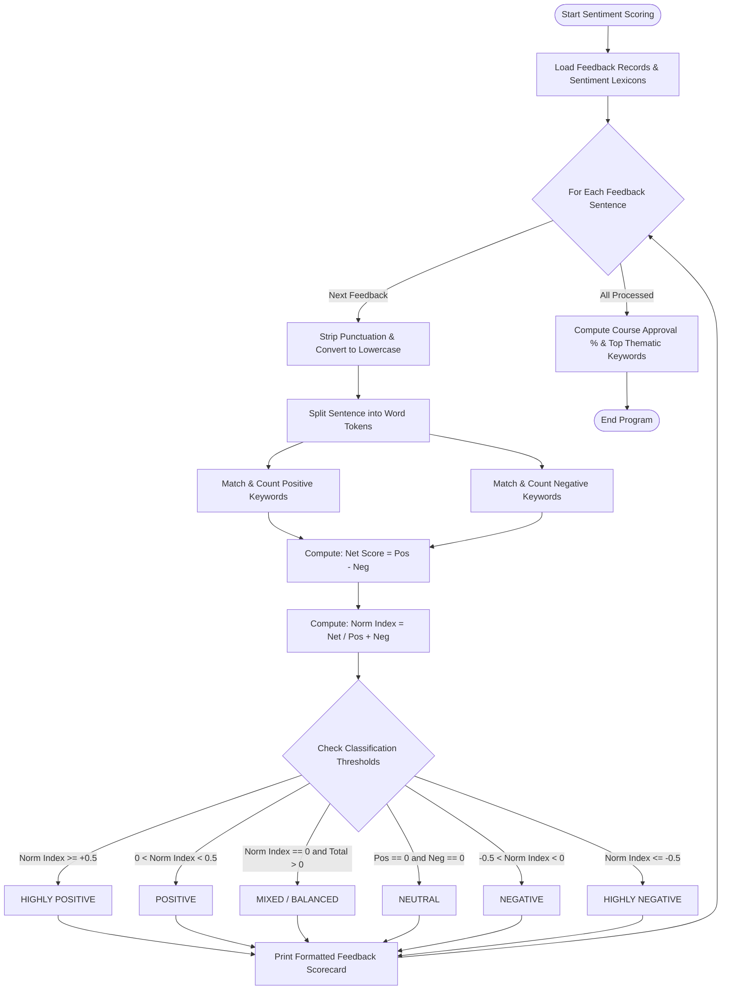

# Case Study 34: Student Feedback Sentiment Scoring

**Course**: Python Programming (Activity-Based Learning - ABL)  
**Institution**: Dr. RVR NRI Institute of Technology  
**Student Name**: Shukur  
**Roll Number**: 24NR1A0501  
**Branch**: Computer Science & Engineering (CSE)  
**Section**: CSE-A  

---

## 1. Problem Statement
At the conclusion of each academic course module, institutions collect qualitative student feedback. Manually reading hundreds of textual feedback statements is labor-intensive, subjective, and prone to evaluator bias. An automated computational text-processing program is needed to evaluate multiple student feedback sentences against supplied domain-specific positive and negative keyword lexicons. The engine must sanitize raw text, count sentiment indicators, calculate net scores and normalized indices, classify each feedback into descriptive sentiment categories, and generate institutional satisfaction metrics.

---

## 2. Objectives
1. Implement a character-by-character text sanitization algorithm to eliminate punctuation without third-party regex packages.
2. Tokenize raw text strings into case-insensitive word lists.
3. Quantify sentiment using keyword matching against predefined positive and negative dictionaries implemented as lists.
4. Calculate two mathematical indicators: Net Sentiment Score ($P - N$) and Normalized Sentiment Index ($\frac{P - N}{P + N}$).
5. Classify feedback statements across 6 qualitative tiers: Highly Positive, Positive, Mixed/Balanced, Neutral, Negative, and Highly Negative.
6. Compute overall course approval ratings and discover primary positive and negative themes.

---

## 3. Assumptions
1. Punctuation characters (`.,!?:;\"'()[]{}<>-/*_~`) do not contribute to sentiment and are replaced with whitespace.
2. Sentiment indicators carry equal weight within their respective sentiment pools.
3. Sentences possessing zero positive and negative keywords are classified as "NEUTRAL (No Keywords)".
4. All operations adhere strictly to first-year syllabus concepts: string slicing, lists, nested loops, and conditionals.

---

## 4. Step-by-Step Algorithm

```
Step 1: Define positive_keywords list and negative_keywords list.
Step 2: Initialize feedback_records as a list of tuples (feedback_id, student_author, text_comment).
Step 3: Define text sanitization function:
    - Iterate through each character of the input string.
    - If the character is in punctuation list, replace with space.
    - Else convert character to lowercase and append to cleaned list.
    - Split cleaned string on whitespace to produce clean tokens.
Step 4: For each feedback in feedback_records:
    Step 4.1: Tokenize the comment using the sanitization function.
    Step 4.2: Count positive keyword matches and negative keyword matches.
    Step 4.3: Calculate sentiment metrics:
              - Net Score = pos_count - neg_count.
              - Normalized Index = (pos_count - neg_count) / (pos_count + neg_count) if (pos + neg) > 0 else 0.0.
    Step 4.4: Classify based on thresholds:
              - If index >= 0.5 or (pos >= 2 and neg == 0): "HIGHLY POSITIVE".
              - Else if index > 0.0: "POSITIVE".
              - Else if index == 0.0 and (pos + neg > 0): "MIXED / BALANCED".
              - Else if index == 0.0: "NEUTRAL (No Keywords)".
              - Else if index > -0.5: "NEGATIVE".
              - Else: "HIGHLY NEGATIVE".
Step 5: Accumulate classification frequencies and keyword hit counters.
Step 6: Compute Net Institutional Course Approval Rating:
        Approval Rate = (Total Positive Feedbacks / Total Feedbacks) * 100.
Step 7: Render formatted detailed statement scorecards and institutional summary.
```

---

## 5. Flowchart



---

## 6. Pseudocode

```text
ALGORITHM FeedbackSentimentScoring:
    INPUT: List feedback_records, List pos_keywords, List neg_keywords
    OUTPUT: Sentence sentiment audits, normalized scores, approval rating

    FOR EACH item IN feedback_records DO:
        id, author, text = item
        tokens = TOKENIZE_AND_CLEAN(text)

        pos_count = 0
        neg_count = 0
        FOR EACH token IN tokens DO:
            IF token IN pos_keywords THEN pos_count = pos_count + 1
            IF token IN neg_keywords THEN neg_count = neg_count + 1
        END FOR

        total_indicators = pos_count + neg_count
        IF total_indicators == 0 THEN:
            net_score = 0
            norm_index = 0.0
            category = "NEUTRAL"
        ELSE:
            net_score = pos_count - neg_count
            norm_index = net_score / total_indicators
            category = CLASSIFY_INDEX(norm_index, pos_count, neg_count)
        END IF

        PRINT feedback scorecard with tokens, matches, and category
    END FOR

    PRINT consolidated distribution and institutional approval rating
END ALGORITHM
```

---

## 7. Python Source Code Listing
The complete implementation is available in [`sentiment_scoring.py`](file:///e:/shukur%20python%20activity%20based%20learning/case_study_34_sentiment_scoring/sentiment_scoring.py).

---

## 8. Test Cases & Verification

| Feedback ID & Author | Input Sentence | Pos / Neg Matches | Net Score | Norm Index | Expected Outcome | Verification Status |
|:---:|:---:|:---:|:---:|:---:|:---:|:---:|
| **FB-01 (Shukur)** | "The Python lectures were excellent, very clear, and extremely engaging!" | 3 / 0 | +3 | +1.00 | HIGHLY POSITIVE | **PASS** |
| **FB-02 (Aarav)** | "The explanation was confusing and the pace was too fast and disorganized." | 0 / 3 | -3 | -1.00 | HIGHLY NEGATIVE | **PASS** |
| **FB-03 (Bhavya)** | "Instructor is good and helpful, but some problem statements are difficult." | 2 / 1 | +1 | +0.33 | POSITIVE | **PASS** |
| **FB-04 (Charan)** | "Today's lab was well structured, interactive, and very supportive." | 3 / 0 | +3 | +1.00 | HIGHLY POSITIVE | **PASS** |
| **FB-05 (Divya)** | "The classroom audio was poor and the explanations were unclear and rushed." | 0 / 3 | -3 | -1.00 | HIGHLY NEGATIVE | **PASS** |
| **FB-06 (Eshwar)** | "Submitted the assignment in room 302 on Friday afternoon." | 0 / 0 | 0 | 0.00 | NEUTRAL (No Keywords) | **PASS** |
| **FB-07 (Farhan)** | "Great examples and inspiring teaching, thoroughly enjoyed the session!" | 2 / 0 | +2 | +1.00 | HIGHLY POSITIVE | **PASS** |

---

## 9. Program Execution Output
```text
================================================================================
                  STUDENT COURSE EVALUATION SENTIMENT ANALYSIS                  
================================================================================
Positive Keywords Monitored (13) : excellent, good, great, helpful, clear, inspiring...
Negative Keywords Monitored (13) : poor, bad, confusing, boring, difficult, unclear...

DETAILED FEEDBACK SENTIMENT BREAKDOWN:
------------------------------------------------------------------------------------------
Feedback #FB-01 by Shukur:
  Comment  : "The Python lectures were excellent, very clear, and extremely engaging!"
  Tokens   : 10 words | Positive matches: 3 ['excellent', 'clear', 'engaging'] | Negative: 0 []
  Scoring  : Net = +3 | Normalized Index = +1.00
  Outcome  : >>> HIGHLY POSITIVE <<<
------------------------------------------------------------------------------------------
Feedback #FB-02 by Aarav:
  Comment  : "The explanation was confusing and the pace was too fast and disorganized."
  Tokens   : 12 words | Positive matches: 0 [] | Negative: 3 ['confusing', 'fast', 'disorganized']
  Scoring  : Net = -3 | Normalized Index = -1.00
  Outcome  : >>> HIGHLY NEGATIVE <<<
------------------------------------------------------------------------------------------
Feedback #FB-03 by Bhavya:
  Comment  : "Instructor is good and helpful, but some problem statements are difficult."
  Tokens   : 11 words | Positive matches: 2 ['good', 'helpful'] | Negative: 1 ['difficult']
  Scoring  : Net = +1 | Normalized Index = +0.33
  Outcome  : >>> POSITIVE <<<
------------------------------------------------------------------------------------------

================================================================================
                      CONSOLIDATED SENTIMENT AUDIT SUMMARY                      
================================================================================
Sentiment Classification   Feedback Count  Percentage     
------------------------------------------------------------
HIGHLY POSITIVE            3               42.9          %
POSITIVE                   1               14.3          %
MIXED / BALANCED           0               0.0           %
NEUTRAL (No Keywords)      1               14.3          %
NEGATIVE                   0               0.0           %
HIGHLY NEGATIVE            2               28.6          %
------------------------------------------------------------

Net Course Approval Rating: 57.1% Positive Sentiment
```

---

## 10. Conclusion & Key Learnings
1. **Natural Language Processing Fundamentals**: Implemented text sanitization, tokenization, stop-character removal, and lexicon scoring from scratch.
2. **Normalized Metrics**: Utilizing a normalized index between $-1.0$ and $+1.0$ resolves sentence length bias, allowing fair comparison between brief and verbose feedback.
3. **Data-Driven Academic Governance**: Provides automated intelligence for department heads to identify specific curricular areas of concern.
