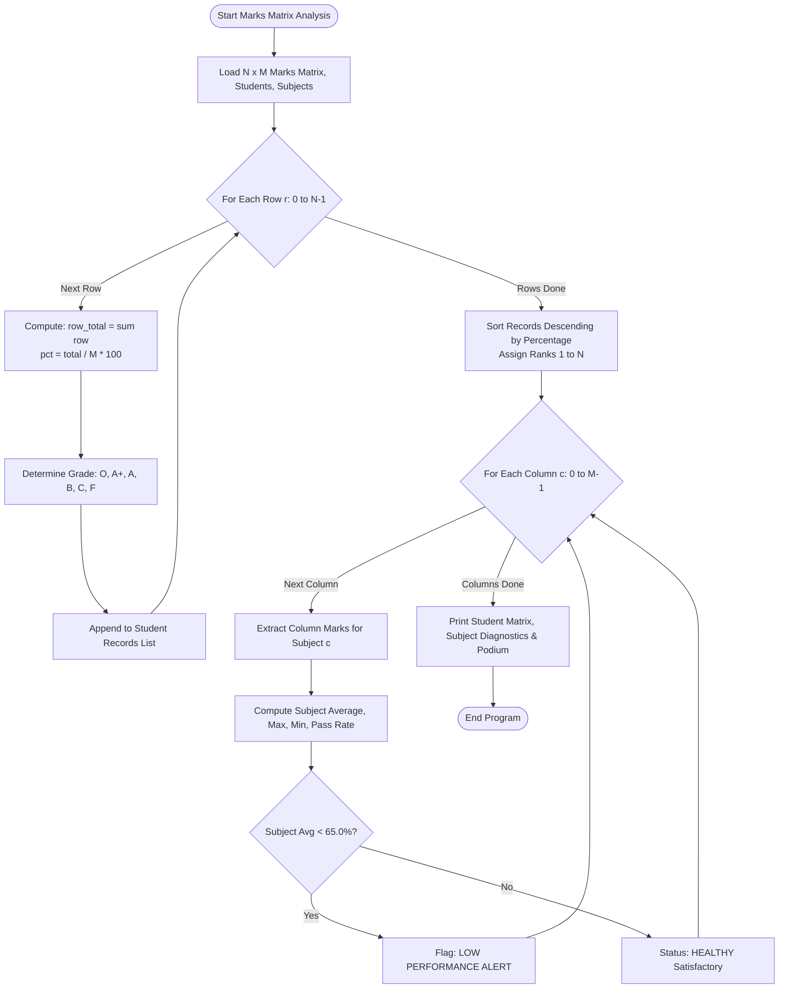

# Case Study 42: Student Marks Matrix Analysis

**Course**: Python Programming (Activity-Based Learning - ABL)  
**Institution**: Dr. RVR NRI Institute of Technology  
**Student Name**: Shukur  
**Roll Number**: 24NR1A0501  
**Branch**: Computer Science & Engineering (CSE)  
**Section**: CSE-A  

---

## 1. Problem Statement
Examinations in collegiate technical programs involve multidimensional performance evaluation across multiple curricular subjects. When stored as a two-dimensional matrix (Rows = Students, Columns = Subjects), data must be analyzed from both perspectives. Row-wise analysis yields individual student totals, aggregate percentages, grades, and merit ranks. Column-wise analysis reveals subject diagnostics, class averages, maximum/minimum scores, and subject pass rates. The system must also identify top academic performers (merit podium) and flag subjects with sub-par average performance ($< 65.0\%$) to direct remedial faculty attention.

---

## 2. Objectives
1. Construct and manipulate 2D nested lists representing a student-subject marks matrix.
2. Execute row-wise traversals to compute student total marks, percentages, and university letter grades.
3. Implement an in-place sorting routine to rank students in descending order of merit.
4. Execute column-wise traversals to compute subject class averages, highest/lowest scores, and pass rates.
5. Identify the top 3 merit podium performers (Gold, Silver, Bronze).
6. Detect curricular subjects that breach minimum academic quality standards ($< 65.0\%$ class average).

---

## 3. Assumptions
1. All subjects carry equal weightage with a maximum score of 100 marks.
2. Passing mark for each subject is established at 40 marks.
3. Institutional subject quality threshold is set at 65.0% average.
4. Matrix rows represent individual students; matrix columns represent sequential subjects.
5. In compliance with the syllabus, no third-party libraries (such as NumPy or Pandas) are utilized.

---

## 4. Step-by-Step Algorithm

```
Step 1: Define lists of student names and curricular subjects.
Step 2: Initialize 2D marks matrix of dimensions N (students) x M (subjects).
Step 3: Row-Wise Processing (Student Scorecards):
    For each row r from 0 to N-1:
        Compute row_total = sum of all scores in row r.
        Compute percentage = (row_total / (M * 100)) * 100.
        Assign letter grade based on percentage:
            >= 90: O (Outstanding)
            >= 80: A+ (Excellent)
            >= 70: A (Very Good)
            >= 60: B (Good)
            >= 50: C (Average)
            < 50 : F (Fail)
        Store student record [name, scores, total, percentage, grade, rank].
Step 4: Rank Assignment:
    Sort student records descending by percentage using bubble sort.
    Assign rank integers 1, 2, ..., N.
Step 5: Column-Wise Processing (Subject Diagnostics):
    For each column c from 0 to M-1:
        Extract all marks in column c into col_scores.
        Compute subject_avg = sum(col_scores) / N.
        Find max_mark and min_mark in col_scores.
        Count passes (mark >= 40) and compute pass_rate = (passes / N) * 100.
        If subject_avg < 65.0%:
            Flag subject as "LOW PERFORMANCE [ALERT]".
Step 6: Output formatted student scorecard matrix, subject diagnostics, merit podium, and remedial alerts.
```

---

## 5. Flowchart



---

## 6. Pseudocode

```text
ALGORITHM StudentMarksMatrixAnalysis:
    INPUT: List students, List subjects, 2D List marks_matrix, Float benchmark_avg
    OUTPUT: Ranked scorecard matrix, subject diagnostics, merit podium

    N = LENGTH(students)
    M = LENGTH(subjects)
    student_records = []

    // 1. Row-Wise Analysis
    FOR r FROM 0 TO N-1 DO:
        scores = marks_matrix[r]
        total = SUM(scores)
        pct = (total / (M * 100.0)) * 100.0
        grade = GET_GRADE(pct)
        student_records.APPEND([students[r], scores, total, pct, grade, 0])
    END FOR

    // Bubble Sort for Ranks
    SORT_BY_PERCENTAGE_DESCENDING(student_records)
    FOR i FROM 0 TO N-1 DO:
        student_records[i].rank = i + 1
    END FOR

    // 2. Column-Wise Analysis
    FOR c FROM 0 TO M-1 DO:
        col_marks = []
        FOR r FROM 0 TO N-1 DO:
            col_marks.APPEND(marks_matrix[r][c])
        END FOR
        s_avg = AVERAGE(col_marks)
        s_max = MAX(col_marks)
        s_min = MIN(col_marks)
        s_pass = (COUNT_GE(col_marks, 40) / N) * 100.0

        IF s_avg < benchmark_avg THEN:
            FLAG_SUBJECT(subjects[c], s_avg, s_pass)
        END IF
    END FOR

    PRINT scorecards, diagnostics, and merit podium
END ALGORITHM
```

---

## 7. Python Source Code Listing
The complete implementation is available in [`marks_matrix.py`](file:///e:/shukur%20python%20activity%20based%20learning/case_study_42_marks_matrix/marks_matrix.py).

---

## 8. Test Cases & Verification

| Student Name | Subject Marks (Math, Python, DS, CO, DM) | Total / 500 | Percentage | Grade | Rank | Verification |
|:---:|:---:|:---:|:---:|:---:|:---:|:---:|
| **Shukur** | `[94, 98, 92, 88, 85]` | 457 | 91.40% | O (Outstanding) | **#1** | **PASS** |
| **Farhan Ali** | `[88, 92, 86, 84, 68]` | 418 | 83.60% | A+ (Excellent) | **#2** | **PASS** |
| **Bhavya Sri** | `[85, 90, 82, 79, 72]` | 408 | 81.60% | A+ (Excellent) | **#3** | **PASS** |
| **Divya Reddy** | `[78, 84, 75, 72, 60]` | 369 | 73.80% | A (Very Good) | **#4** | **PASS** |
| **Aarav Kumar** | `[68, 74, 58, 62, 42]` | 304 | 60.80% | B (Good) | **#5** | **PASS** |
| **Eshwar Rao** | `[52, 60, 45, 50, 38]` | 245 | 49.00% | F (Fail) | **#6** | **PASS** |
| **Charan Teja** | `[42, 55, 38, 48, 30]` | 213 | 42.60% | F (Fail) | **#7** | **PASS** |

---

## 9. Program Execution Output
```text
========================================================================================
                         ACADEMIC PERFORMANCE MATRIX EVALUATION                         
========================================================================================
Cohort Size: 7 Students | Curricular Subjects: 5
Institutional Quality Benchmark Subject Average: 65.0%

SECTION 1: STUDENT SCORECARD MATRIX (ROW-WISE ANALYSIS)
Rank  Student Name      Mathematic  Python Pro  Data Struc  Comp. Org.  Discrete M    Total    Pct %  Grade
-----------------------------------------------------------------------------------------------------------
#1    Shukur                    94          98          92          88          85      457   91.40%  O  (Outstanding)
#2    Farhan Ali                88          92          86          84          68      418   83.60%  A+ (Excellent)
#3    Bhavya Sri                85          90          82          79          72      408   81.60%  A+ (Excellent)
#4    Divya Reddy               78          84          75          72          60      369   73.80%  A  (Very Good)
#5    Aarav Kumar               68          74          58          62          42      304   60.80%  B  (Good)
#6    Eshwar Rao                52          60          45          50          38      245   49.00%  F  (Fail)
#7    Charan Teja               42          55          38          48          30      213   42.60%  F  (Fail)
-----------------------------------------------------------------------------------------------------------

SECTION 2: CURRICULAR SUBJECT DIAGNOSTICS (COLUMN-WISE ANALYSIS)
Subject Name               Avg Mark    Highest     Lowest  Pass Rate % Curricular Status   
--------------------------------------------------------------------------------------------
Mathematics                   72.43         94         42       100.0% HEALTHY (Satisfactory)
Python Prog                   79.00         98         55       100.0% HEALTHY (Satisfactory)
Data Structures               68.00         92         38        85.7% HEALTHY (Satisfactory)
Comp. Org.                    69.00         88         48       100.0% HEALTHY (Satisfactory)
Discrete Math                 56.43         85         30        71.4% LOW PERFORMANCE [ALERT]
--------------------------------------------------------------------------------------------

SECTION 3: ACADEMIC MERIT PODIUM (TOP PERFORMERS)
[*] GOLD MEDALIST (Rank 1)    : Shukur - Total: 457/500 (91.40%) [O  (Outstanding)]
[*] SILVER MEDALIST (Rank 2)  : Farhan Ali - Total: 418/500 (83.60%) [A+ (Excellent)]
[*] BRONZE MEDALIST (Rank 3)  : Bhavya Sri - Total: 408/500 (81.60%) [A+ (Excellent)]

SECTION 4: INSTITUTIONAL REMEDIAL ACTION ALERTS:
[!] 'Discrete Math' class average of 56.43% (Pass rate: 71.4%) is BELOW the 65.0% threshold.
    Recommendation: Conduct remedial tutorials, revise foundational topics, and hold doubt-clearing clinics.
```

---

## 10. Conclusion & Key Learnings
1. **Bidirectional Matrix Traversal**: Demonstrated orthogonal 2D list manipulation: row iterations calculate individual student metrics, while transposed column iterations calculate subject-wide health.
2. **Algorithmic Sorting**: Implemented an in-place bubble sorting algorithm to assign accurate academic ranks without relying on external libraries.
3. **Institutional Intelligence**: Proactively detected subject-level weakness (Discrete Math average 56.43%), providing actionable data for academic remediation.

