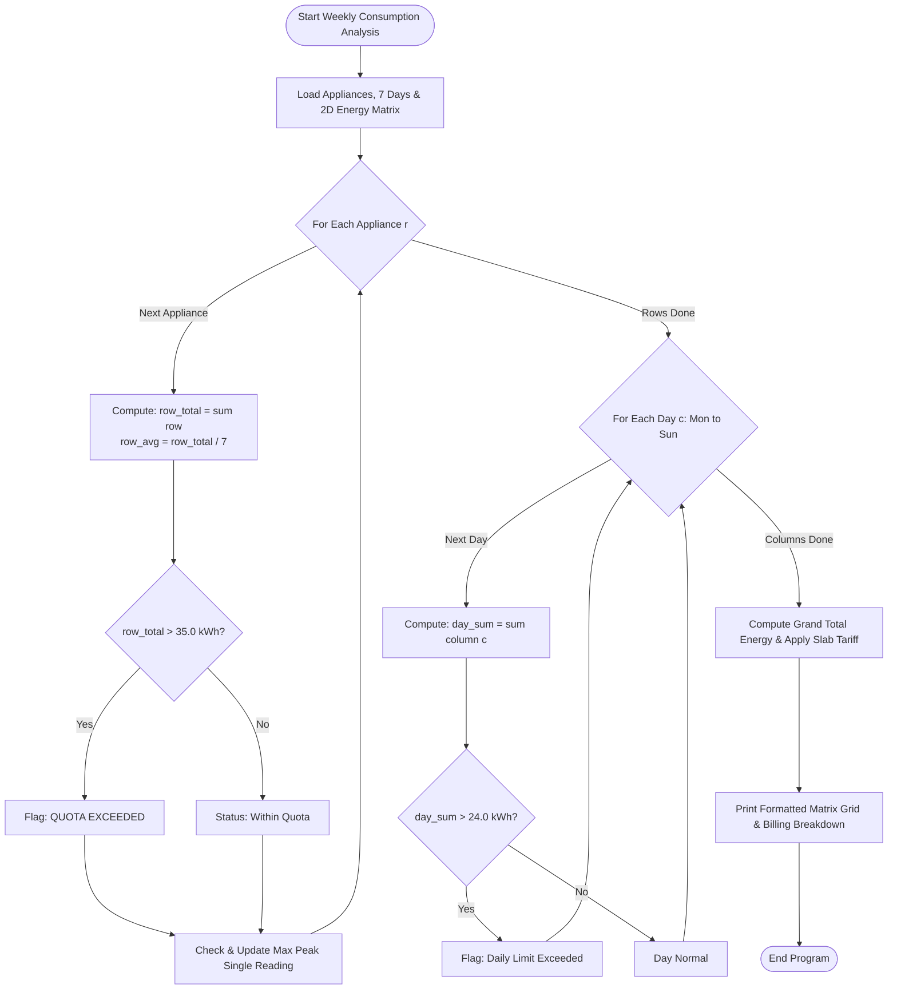

# Case Study 45: Weekly Electricity Consumption Matrix

**Course**: Python Programming (Activity-Based Learning - ABL)  
**Institution**: Dr. RVR NRI Institute of Technology  
**Student Name**: Shukur  
**Roll Number**: 24NR1A0501  
**Branch**: Computer Science & Engineering (CSE)  
**Section**: CSE-A  

---

## 1. Problem Statement
Energy conservation in residential and commercial facilities requires granular accounting of electrical consumption at the individual appliance level. Monitoring aggregate meter readings obscures power-hungry appliances and sudden load spikes. A computational analysis system is required to process a 2D matrix of daily electricity readings (kWh) across 7 days for multiple appliances. The system must calculate weekly totals and daily averages per appliance (row-wise), daily aggregate household consumption (column-wise), detect peak consumption events, flag days breaching safe household limits ($> 24.0$ kWh/day), identify appliances exceeding allocated quotas ($> 35.0$ kWh/week), and compute tiered electricity tariff costs.

---

## 2. Objectives
1. Model appliance-level energy telemetry across a 7-day week using 2D nested lists ($6 \times 7$ matrix).
2. Calculate appliance-wise total energy consumption and daily averages.
3. Compute day-wise cumulative consumption across all active household appliances.
4. Detect the peak consumption surge event across the entire weekly operating window.
5. Flag daily threshold breaches ($> 24.0$ kWh) and weekly appliance quota breaches ($> 35.0$ kWh).
6. Implement a multi-slab tariff calculation to estimate weekly energy utility costs.

---

## 3. Assumptions
1. Readings are recorded in kilowatt-hours (kWh) at the conclusion of each operating day.
2. The observation horizon spans 7 continuous days (Monday through Sunday).
3. Daily safety ceiling is established at 24.0 kWh/day; weekly appliance quota ceiling is set at 35.0 kWh/week.
4. Electricity tariff rates: First 50 units @ INR 3.50/unit; Next 50 units @ INR 5.00/unit; Units $> 100$ @ INR 7.50/unit; Fixed maintenance charge = INR 65.00.

---

## 4. Step-by-Step Algorithm

```
Step 1: Define list of appliances and list of days (Mon through Sun).
Step 2: Initialize 2D energy matrix of dimensions R (appliances) x C (7 days).
Step 3: Row-Wise Appliance Aggregation:
    For each appliance r from 0 to R-1:
        Compute row_total = sum(readings in row r).
        Compute row_avg = row_total / 7.
        Check if row_total > appliance_limit (35.0 kWh):
            If yes, flag as "QUOTA EXCEEDED [ALERT]".
        Scan readings to find overall peak single event:
            If reading > peak_val, update peak_val, peak_appliance, and peak_day.
Step 4: Column-Wise Daily Aggregation:
    For each day c from 0 to 6:
        Compute day_sum = sum of consumption across all appliances for day c.
        Check if day_sum > daily_limit (24.0 kWh):
            If yes, flag day as safety limit breach.
Step 5: Compute grand total weekly energy = sum of daily totals.
Step 6: Tariff Calculation:
    Calculate energy bill based on tiered slabs:
    - First 50 units @ INR 3.50.
    - Next 50 units @ INR 5.00.
    - Units above 100 @ INR 7.50.
    - Add INR 65.00 fixed maintenance charge.
Step 7: Render formatted matrix grid, surge alerts, threshold reports, and financial billing statement.
```

---

## 5. Flowchart



---

## 6. Pseudocode

```text
ALGORITHM WeeklyElectricityConsumptionMatrix:
    INPUT: List appliances, List days, 2D List consumption_matrix, Float daily_limit, Float app_limit
    OUTPUT: Formatted consumption grid, peak event, quota alerts, billing statement

    R = LENGTH(appliances)
    C = LENGTH(days)

    peak_val = 0.0
    appliance_totals = []
    over_limit_apps = []

    // 1. Appliance Totals (Rows)
    FOR r FROM 0 TO R-1 DO:
        row = consumption_matrix[r]
        r_tot = SUM(row)
        r_avg = r_tot / C
        appliance_totals.APPEND(r_tot)

        IF r_tot > app_limit THEN:
            over_limit_apps.APPEND((appliances[r], r_tot))
        END IF

        FOR c FROM 0 TO C-1 DO:
            IF row[c] > peak_val THEN:
                peak_val = row[c]
                peak_app = appliances[r]
                peak_day = days[c]
            END IF
        END FOR
    END FOR

    // 2. Daily Totals (Columns)
    daily_totals = []
    over_limit_days = []
    FOR c FROM 0 TO C-1 DO:
        d_sum = 0
        FOR r FROM 0 TO R-1 DO:
            d_sum = d_sum + consumption_matrix[r][c]
        END FOR
        daily_totals.APPEND(d_sum)
        IF d_sum > daily_limit THEN:
            over_limit_days.APPEND((days[c], d_sum))
        END IF
    END FOR

    grand_total = SUM(daily_totals)
    bill_amount = CALCULATE_TARIFF(grand_total)

    PRINT consumption table, peak event, limit violations, and bill breakdown
END ALGORITHM
```

---

## 7. Python Source Code Listing
The complete implementation is available in [`electricity_consumption.py`](file:///e:/shukur%20python%20activity%20based%20learning/case_study_45_electricity_consumption/electricity_consumption.py).

---

## 8. Test Cases & Verification

| Appliance Name | Mon - Sun Readings (kWh) | Weekly Total | Daily Avg | Quota Status ($> 35$ kWh) | Verification |
|:---:|:---:|:---:|:---:|:---:|:---:|
| **Air Conditioner (2.0 TR)** | `[7.5, 8.0, 7.8, 8.2, 9.0, 11.5, 12.0]` | 64.0 kWh | 9.1 kWh | **QUOTA EXCEEDED [ALERT]** | **PASS** |
| **Refrigerator** | `[2.2, 2.1, 2.3, 2.2, 2.4, 2.5, 2.4]` | 16.1 kWh | 2.3 kWh | Within Quota | **PASS** |
| **Geyser / Water Heater** | `[4.0, 3.8, 4.2, 3.9, 4.1, 4.5, 4.8]` | 29.3 kWh | 4.2 kWh | Within Quota | **PASS** |
| **Washing Machine** | `[0.0, 1.5, 0.0, 1.6, 0.0, 2.2, 2.0]` | 7.3 kWh | 1.0 kWh | Within Quota | **PASS** |
| **Lighting & Fans** | `[3.0, 3.2, 3.1, 3.0, 3.5, 4.0, 4.2]` | 24.0 kWh | 3.4 kWh | Within Quota | **PASS** |
| **Microwave & Induction**| `[1.8, 1.5, 1.9, 1.6, 2.0, 2.8, 3.0]` | 14.6 kWh | 2.1 kWh | Within Quota | **PASS** |

---

## 9. Program Execution Output
```text
========================================================================================
                     HOUSEHOLD WEEKLY ELECTRICITY CONSUMPTION AUDIT                     
========================================================================================
Audit Horizon           : 7 Full Operating Days (Mon to Sun)
Daily Safety Limit      : 24.0 kWh / day
Weekly Appliance Quota  : 35.0 kWh / week

#   Appliance                      Mon     Tue     Wed     Thu     Fri     Sat     Sun     Total   Avg/Day  Audit Status
------------------------------------------------------------------------------------------------------------------------
1   Air Conditioner (2.0 TR)       7.5     8.0     7.8     8.2     9.0    11.5    12.0      64.0       9.1  QUOTA EXCEEDED [ALERT]
2   Refrigerator (Double Door)     2.2     2.1     2.3     2.2     2.4     2.5     2.4      16.1       2.3  Within Quota
3   Geyser / Water Heater          4.0     3.8     4.2     3.9     4.1     4.5     4.8      29.3       4.2  Within Quota
4   Washing Machine                0.0     1.5     0.0     1.6     0.0     2.2     2.0       7.3       1.0  Within Quota
5   Lighting & Ceiling Fans        3.0     3.2     3.1     3.0     3.5     4.0     4.2      24.0       3.4  Within Quota
6   Microwave & Induction          1.8     1.5     1.9     1.6     2.0     2.8     3.0      14.6       2.1  Within Quota
------------------------------------------------------------------------------------------------------------------------
    DAILY TOTAL (kWh)             18.5    20.1    19.3    20.5    21.0    27.5    28.4     155.3      22.2
------------------------------------------------------------------------------------------------------------------------

SURGE & PEAK LOAD ANALYSIS:
[*] Peak Single Consumption Event : 12.00 kWh by 'Air Conditioner (2.0 TR)' on Sun.

DAILY HOUSEHOLD LIMIT AUDIT (> 24.0 kWh):
[!] Sat: Total 27.5 kWh exceeded safety threshold by +3.5 kWh.
[!] Sun: Total 28.4 kWh exceeded safety threshold by +4.4 kWh.

APPLIANCE QUOTA BREACH AUDIT (> 35.0 kWh/week):
[!] 'Air Conditioner (2.0 TR)': Used 64.0 kWh, exceeding assigned quota by +29.0 kWh.

ESTIMATED TARIFF & BILLING BREAKDOWN:
- Cumulative Energy Consumed : 155.30 kWh
- Energy Charges (Slab rate) : INR 839.75
- Grid Fixed Maintenance Fee : INR 65.00
- Estimated Net Weekly Bill  : INR 904.75
```

---

## 10. Conclusion & Key Learnings
1. **Weekend Load Profile Detection**: Column-wise analysis revealed significant weekend energy surges (Saturday 27.5 kWh and Sunday 28.4 kWh), driven primarily by prolonged air conditioning.
2. **Appliance Attribution**: By isolating appliance consumption, the audit clearly proved that the Air Conditioner accounted for 41.2% of total household consumption.
3. **Utility Billing Automation**: Integrated progressive tariff calculation demonstrates computational financial modeling using pure conditionals and arithmetic expressions.

