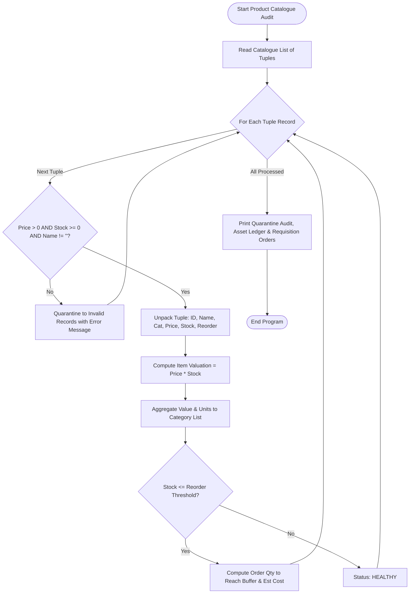

# Case Study 49: Tuple-Based Product Catalogue Audit

**Course**: Python Programming (Activity-Based Learning - ABL)  
**Institution**: Dr. RVR NRI Institute of Technology  
**Student Name**: Shukur  
**Roll Number**: 24NR1A0501  
**Branch**: Computer Science & Engineering (CSE)  
**Section**: CSE-A  

---

## 1. Problem Statement
Enterprise warehouse inventory management requires strict record immutability to ensure financial and auditing compliance. Tuples provide the optimal Python data structure for catalogue records because their values cannot be inadvertently modified during execution. However, incoming raw data feeds frequently contain schema corruptions, negative prices, missing product names, or negative inventory counts. A comprehensive inventory audit suite is required to validate incoming product tuples, quarantine defective records, calculate item-wise and category-wise inventory valuations, identify products breaching reorder thresholds, and generate purchase orders with estimated procurement capital.

---

## 2. Objectives
1. Model master inventory catalogue records using immutable Python tuples:  
   `(product_id, product_name, category, unit_price, stock_quantity, reorder_threshold)`.
2. Implement schema validation routines to quarantine corrupt records (negative prices, negative stock, blank names).
3. Compute total financial asset valuations across items and categories using tuple unpacking.
4. Detect replenishment requirements (`stock_quantity <= reorder_threshold`) and categorize criticality.
5. Compute optimal purchase reorder quantities and estimate needed procurement capital.

---

## 3. Assumptions
1. Tuple structure strictly requires 6 elements in the designated order.
2. Prices and quantities must be non-negative numbers ($> 0$ for price, $\ge 0$ for quantities).
3. When stock is at or below the reorder threshold, a purchase requisition is triggered to reach a target buffer of $\max(2 \times \text{reorder}, \text{reorder} + 10)$.
4. In compliance with first-year syllabus rules, no dictionaries or sets are used; category aggregations are managed via lists of lists.

---

## 4. Step-by-Step Algorithm

```
Step 1: Ingest raw catalogue records stored as a list of tuples.
Step 2: Initialize lists: valid_products, invalid_records, category_summary, replenishment_orders.
Step 3: Tuple Validation Phase:
    For each record in raw_catalogue:
        Check: length == 6, product_id is non-empty string, product_name is non-empty string,
               unit_price is numeric > 0, stock_quantity is integer >= 0, reorder_threshold >= 0.
        If all checks pass: Append record to valid_products.
        Else: Append (record, error_reason) to invalid_records.
Step 4: Inventory Valuation Phase (Tuple Unpacking):
    For each product in valid_products:
        Unpack: (pid, name, cat, price, stock, reorder) = product.
        Compute item_value = price * stock.
        Accumulate to grand_inventory_value and total_stock_units.
        Category Aggregation: Search for category in category_summary;
            If found: accumulate valuation and units;
            Else: append [cat, item_value, stock].
Step 5: Replenishment Audit:
    If stock <= reorder:
        If stock == 0: Priority = "CRITICAL (Out of Stock)", else Priority = "HIGH".
        target_stock = max(2 * reorder, reorder + 10).
        order_qty = target_stock - stock.
        estimated_cost = order_qty * price.
        Append to replenishment_orders.
Step 6: Output quarantined record report, inventory asset ledger, category distribution, and purchase requisition table.
```

---

## 5. Flowchart



---

## 6. Pseudocode

```text
ALGORITHM TupleProductCatalogueAudit:
    INPUT: List raw_catalogue
    OUTPUT: Validated inventory ledger, quarantined records, purchase requisition

    valid_products = []
    invalid_records = []

    FOR EACH item IN raw_catalogue DO:
        is_valid, err = VALIDATE(item)
        IF is_valid THEN:
            valid_products.APPEND(item)
        ELSE:
            invalid_records.APPEND((item, err))
        END IF
    END FOR

    grand_total_val = 0.0
    replenishment_list = []

    FOR EACH prod IN valid_products DO:
        pid, name, cat, price, stock, reorder = prod
        item_val = price * stock
        grand_total_val = grand_total_val + item_val

        IF stock <= reorder THEN:
            target = MAX(2 * reorder, reorder + 10)
            order_qty = target - stock
            cost = order_qty * price
            replenishment_list.APPEND((pid, name, stock, reorder, order_qty, cost))
        END IF
    END FOR

    PRINT quarantined records, inventory ledger, and purchase orders
END ALGORITHM
```

---

## 7. Python Source Code Listing
The complete implementation is available in [`product_catalogue.py`](file:///e:/shukur%20python%20activity%20based%20learning/case_study_49_product_catalogue/product_catalogue.py).

---

## 8. Test Cases & Verification

| Product ID & Name | Price (INR) | Stock | Reorder Level | Valuation (INR) | Audit Action | Verification |
|:---:|:---:|:---:|:---:|:---:|:---:|:---:|
| **PRD101 - Ergonomic Mouse** | 1,250.00 | 45 | 15 | 56,250.00 | HEALTHY | **PASS** |
| **PRD102 - Gaming Keyboard** | 3,499.00 | 8 | 10 | 27,992.00 | REORDER (Order 12) | **PASS** |
| **PRD103 - Headset** | 5,999.00 | 3 | 5 | 17,997.00 | REORDER (Order 12) | **PASS** |
| **PRD104 - USB-C Hub** | 1,850.00 | 60 | 20 | 111,000.00 | HEALTHY | **PASS** |
| **PRD105 - 4K Monitor** | 28,500.00 | 0 | 4 | 0.00 | **CRITICAL: OUT OF STOCK** | **PASS** |
| **PRD109 - Defective Price** | -450.00 | 10 | 5 | - | **QUARANTINED (Negative Price)** | **PASS** |
| **PRD110 - Empty Name** | 800.00 | 15 | 5 | - | **QUARANTINED (Missing Name)** | **PASS** |
| **PRD111 - Negative Stock** | 2,500.00 | -4 | 2 | - | **QUARANTINED (Negative Stock)** | **PASS** |

---

## 9. Program Execution Output
```text
========================================================================================
                ENTERPRISE PRODUCT CATALOGUE INTEGRITY & INVENTORY AUDIT                
========================================================================================
Total Catalogue Records Ingested: 11

SECTION 1: CATALOGUE SANITY & INTEGRITY VALIDATION
[!] Detected 3 corrupt/invalid records. Quarantined for review:
    - Quarantined: ('PRD109', 'Defective Pricing Item', 'Hardware', -450.0, 10, 5) --> REASON: Invalid unit price (-450.0): Must be positive numeric
    - Quarantined: ('PRD110', '', 'Accessories', 800.0, 15, 5) --> REASON: Invalid or missing Product Name
    - Quarantined: ('PRD111', 'Negative Stock Barcode', 'Hardware', 2500.0, -4, 2) --> REASON: Invalid stock quantity (-4): Must be non-negative integer
----------------------------------------------------------------------------------------

SECTION 2: CERTIFIED PRODUCT INVENTORY VALUATION LEDGER
ID       Product Name             Category        Price (INR)    Stock    Value (INR) Stock Status
--------------------------------------------------------------------------------------------------
PRD101   Wireless Ergonomic Mouse Electronics       1,250.00       45      56,250.00 HEALTHY     
PRD102   Mechanical Gaming Keyboard Electronics       3,499.00        8      27,992.00 REORDER     
PRD103   Noise Cancelling Headset Electronics       5,999.00        3      17,997.00 REORDER     
PRD104   USB-C Fast Charging Hub  Accessories       1,850.00       60     111,000.00 HEALTHY     
PRD105   27-inch 4K IPS Monitor   Hardware         28,500.00        0           0.00 OUT OF STOCK
PRD106   Aluminum Laptop Riser    Accessories       1,450.00       22      31,900.00 HEALTHY     
PRD107   CAT-6 Ethernet Cable 5m  Networking          350.00      110      38,500.00 HEALTHY     
PRD108   Thunderbolt 4 Dock       Hardware         14,999.00        5      74,995.00 REORDER     
--------------------------------------------------------------------------------------------------
Grand Total Warehouse Stock Units : 253 Units
Grand Total Inventory Asset Value : INR 358,634.00

SECTION 3: CATEGORY-WISE ASSET VALUATION
Category              Total Units    Valuation (INR)   Asset Share %
--------------------------------------------------------------------
Electronics                    56         102,239.00           28.5%
Accessories                    82         142,900.00           39.8%
Hardware                        5          74,995.00           20.9%
Networking                    110          38,500.00           10.7%
--------------------------------------------------------------------

SECTION 4: REPLENISHMENT PURCHASE REQUISITION
ID       Product Name              Current  Min Level   Order Qty  Est. Cost (INR) Priority  
----------------------------------------------------------------------------------------------
PRD102   Mechanical Gaming Keyboard        8         10          12        41,988.00 HIGH      
PRD103   Noise Cancelling Headset        3          5          12        71,988.00 HIGH      
PRD105   27-inch 4K IPS Monitor          0          4          14       399,000.00 CRITICAL  
PRD108   Thunderbolt 4 Dock              5          5          10       149,990.00 HIGH      
----------------------------------------------------------------------------------------------
Total Items Requiring Purchase   : 4
Total Reorder Capital Required   : INR 662,966.00
```

---

## 10. Conclusion & Key Learnings
1. **Tuple Security & Immutability**: Encapsulating inventory state inside tuples guarantees that operational functions cannot unintentionally mutate master records.
2. **Defensive Programming**: Validating and quarantining defective tuples prevents runtime errors and corrupted financial reporting.
3. **Automated Procurement Intelligence**: Calculates exact reorder quantities and estimates required purchase capital, connecting programming to business supply chain operations.
