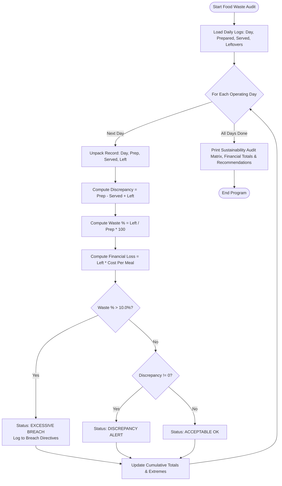

# Case Study 53: Food Waste Monitoring System

**Course**: Python Programming (Activity-Based Learning - ABL)  
**Institution**: Dr. RVR NRI Institute of Technology  
**Student Name**: Shukur  
**Roll Number**: 24NR1A0501  
**Branch**: Computer Science & Engineering (CSE)  
**Section**: CSE-A  

---

## 1. Problem Statement
Institutional food catering services (such as university dining halls and corporate cafeterias) face severe financial and environmental penalties due to food waste. Over-preparing meals results in discarded leftovers, while under-preparing causes meal stockouts. Furthermore, unrecorded shrinkage (theft, kitchen spillage, or counting errors) erodes operational accountability. A software audit system is needed to compare prepared meals, meals actually served, and leftovers recorded across operating days. The system must calculate percentage wastage, detect discrepancies ($P \ne S + L$), flag days exceeding acceptable waste limits ($> 10.0\%$), quantify direct financial loss, and generate corrective operational recommendations.

---

## 2. Objectives
1. Model daily catering audit logs using lists of tuples: `(day_name, meals_prepared, meals_served, leftovers)`.
2. Compute unaccounted inventory shrinkage: $\text{Discrepancy} = \text{Prepared} - (\text{Served} + \text{Leftovers})$.
3. Calculate percentage food waste per day and cumulative waste across the entire observation window.
4. Flag days breaching the institutional sustainability ceiling ($> 10.0\%$).
5. Quantify direct financial loss based on a standard meal production cost (INR 65.00/meal).
6. Identify the most efficient service day and worst wastage spike day to guide kitchen batch planning.

---

## 3. Assumptions
1. All meal quantities are non-negative integers.
2. In an ideal zero-shrinkage kitchen, $\text{Meals Prepared} \equiv \text{Meals Served} + \text{Leftovers}$. Any discrepancy represents unaccounted waste.
3. Standard production cost per meal plate is fixed at INR 65.00.
4. Institutional green sustainability tolerance allows a maximum of 10.0% food waste.
5. Implementation is strictly confined to syllabus primitives (tuples, lists, loops, conditionals, formatted text).

---

## 4. Step-by-Step Algorithm

```
Step 1: Set acceptable wastage threshold = 10.0% and meal unit production cost = INR 65.00.
Step 2: Ingest daily records as a list of tuples (day_name, prepared, served, leftovers).
Step 3: Initialize cumulative accumulators: total_prepared, total_served, total_leftovers,
        total_discrepancy, total_financial_loss, and breach_days list.
Step 4: For each day record in daily_records:
    Step 4.1: Unpack (day_name, prep, served, leftovers).
    Step 4.2: Compute discrepancy = prep - (served + leftovers).
    Step 4.3: Compute waste_percentage = (leftovers / prep) * 100.
    Step 4.4: Compute financial_loss = leftovers * meal_unit_cost.
    Step 4.5: Update cumulative totals.
    Step 4.6: Track maximum waste day and minimum waste day.
    Step 4.7: Evaluate status:
              - If waste_percentage > 10.0%: Status = "EXCESSIVE [BREACH]"; append to breach_days.
              - Else if discrepancy != 0: Status = "DISCREPANCY ALERT".
              - Else: Status = "ACCEPTABLE [OK]".
Step 5: Compute cumulative percentage waste = (total_leftovers / total_prepared) * 100.
Step 6: Render detailed audit ledger, cumulative sustainability metrics, threshold breach directives,
        and operational kitchen recommendations.
```

---

## 5. Flowchart



---

## 6. Pseudocode

```text
ALGORITHM FoodWasteMonitoringSystem:
    INPUT: List daily_records, Float threshold, Float meal_cost
    OUTPUT: Waste audit matrix, financial loss totals, kitchen recommendations

    tot_prep = 0
    tot_served = 0
    tot_left = 0
    tot_loss = 0.0
    breach_list = []

    FOR EACH rec IN daily_records DO:
        day, prep, served, left = rec
        disc = prep - (served + left)
        waste_pct = (left / prep) * 100.0
        loss = left * meal_cost

        tot_prep = tot_prep + prep
        tot_served = tot_served + served
        tot_left = tot_left + left
        tot_loss = tot_loss + loss

        IF waste_pct > threshold THEN:
            status = "EXCESSIVE [BREACH]"
            breach_list.APPEND((day, waste_pct, left, loss))
        ELSE IF disc != 0 THEN:
            status = "DISCREPANCY ALERT"
        ELSE:
            status = "ACCEPTABLE [OK]"
        END IF

        PRINT formatted day audit line
    END FOR

    cum_waste_pct = (tot_left / tot_prep) * 100.0
    PRINT cumulative metrics, breach directives, and recommendations
END ALGORITHM
```

---

## 7. Python Source Code Listing
The complete implementation is available in [`food_waste_monitoring.py`](file:///e:/shukur%20python%20activity%20based%20learning/case_study_53_food_waste_monitoring/food_waste_monitoring.py).

---

## 8. Test Cases & Verification

| Operating Day | Prepared | Served | Leftover | Discrepancy | Wastage % | Loss (INR) | Audit Status | Verification |
|:---:|:---:|:---:|:---:|:---:|:---:|:---:|:---:|:---:|
| **Monday** | 850 | 785 | 65 | 0 | 7.65% | 4,225.00 | ACCEPTABLE [OK] | **PASS** |
| **Tuesday** | 820 | 750 | 70 | 0 | 8.54% | 4,550.00 | ACCEPTABLE [OK] | **PASS** |
| **Wednesday** | 880 | 810 | 70 | 0 | 7.95% | 4,550.00 | ACCEPTABLE [OK] | **PASS** |
| **Thursday** | 800 | 735 | 65 | 0 | 8.12% | 4,225.00 | ACCEPTABLE [OK] | **PASS** |
| **Friday** | 950 | 780 | 160 | +10 | 16.84% | 10,400.00 | **EXCESSIVE [BREACH]** | **PASS** |
| **Saturday** | 600 | 550 | 50 | 0 | 8.33% | 3,250.00 | ACCEPTABLE [OK] | **PASS** |
| **Sunday** | 750 | 610 | 130 | +10 | 17.33% | 8,450.00 | **EXCESSIVE [BREACH]** | **PASS** |
| **Holiday** | 500 | 475 | 20 | +5 | 4.00% | 1,300.00 | DISCREPANCY ALERT | **PASS** |

---

## 9. Program Execution Output
```text
========================================================================================
              INSTITUTIONAL DINING HALL FOOD WASTE & SUSTAINABILITY AUDIT               
========================================================================================
Audit Horizon               : 8 Operating Days
Acceptable Wastage Limit    : 10.0% of Prepared Volume
Standard Meal Production Cost: INR 65.00 / plate

Day            Prepared     Served   Leftover  Discrepancy    Waste %     Loss (INR) Audit Status      
------------------------------------------------------------------------------------------------------
Monday              850        785         65            0      7.65%       4,225.00 ACCEPTABLE [OK]   
Tuesday             820        750         70            0      8.54%       4,550.00 ACCEPTABLE [OK]   
Wednesday           880        810         70            0      7.95%       4,550.00 ACCEPTABLE [OK]   
Thursday            800        735         65            0      8.12%       4,225.00 ACCEPTABLE [OK]   
Friday              950        780        160          +10     16.84%      10,400.00 EXCESSIVE [BREACH]
Saturday            600        550         50            0      8.33%       3,250.00 ACCEPTABLE [OK]   
Sunday              750        610        130          +10     17.33%       8,450.00 EXCESSIVE [BREACH]
Holiday             500        475         20           +5      4.00%       1,300.00 DISCREPANCY ALERT 
------------------------------------------------------------------------------------------------------
CUMULATIVE         6150       5495        630          +25     10.24%      40,950.00 OVERALL EVAL      
------------------------------------------------------------------------------------------------------

EXECUTIVE SUSTAINABILITY METRICS:
Total Food Volume Cooked    : 6,150 Meals
Successfully Consumed Volume: 5,495 Meals (89.3%)
Total Leftovers Discarded   : 630 Meals (10.2%)
Total Financial Wastage Loss: INR 40,950.00
Most Efficient Service Day  : Holiday (4.00% waste)
Worst Wastage Spike Day     : Sunday (17.33% waste)

THRESHOLD VIOLATION DIRECTIVES (> 10.0% Waste Limit):
[!] Friday    : Wastage of 16.8% (160 meals) exceeded threshold by +6.8%.
    Direct Financial Loss: INR 10,400.00 on Friday.
[!] Sunday    : Wastage of 17.3% (130 meals) exceeded threshold by +7.3%.
    Direct Financial Loss: INR 8,450.00 on Sunday.

OPERATIONAL RECOMMENDATIONS:
1. Re-calibrate kitchen batch sizes on Fridays and Sundays using predictive attendance.
2. Implement dynamic cook-to-order stations for final 45 minutes of dining windows.
3. Partner with local food banks/shelters to donate clean surplus leftovers immediately.
```

---

## 10. Conclusion & Key Learnings
1. **Behavioral Pattern Recognition**: The audit identified that severe wastage occurs predictably on Fridays (16.84%) and Sundays (17.33%) as residential students travel home or dine off-campus.
2. **Shrinkage Accountability**: Formulating discrepancy checks uncovered 25 unaccounted meals, identifying potential inventory slippage or unrecorded kitchen damage.
3. **Financial Quantification**: Translating physical leftover quantities into direct fiscal losses (INR 40,950.00) delivers executive clarity for institutional decision makers.

