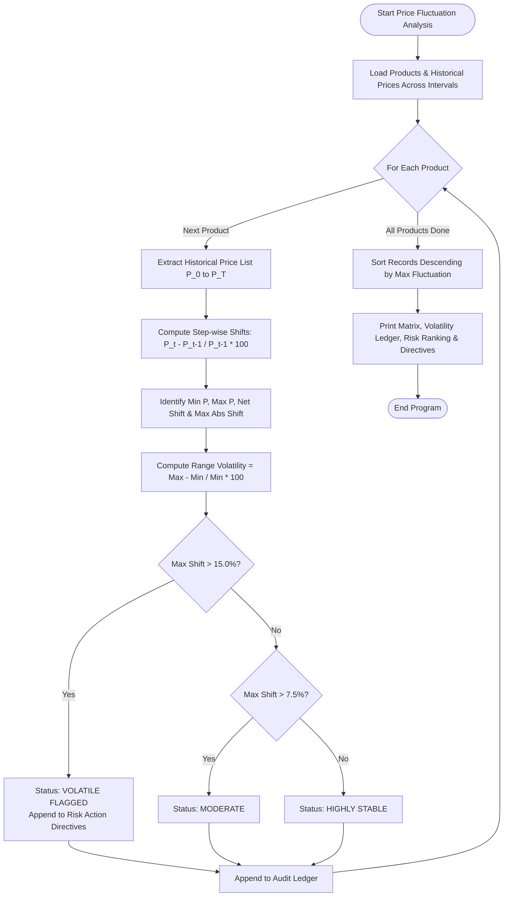

# Case Study 63: Multi-Product Price Fluctuation Analysis

**Course**: Python Programming (Activity-Based Learning - ABL)  
**Institution**: Dr. RVR NRI Institute of Technology  
**Student Name**: Shukur  
**Roll Number**: 24NR1A0501  
**Branch**: Computer Science & Engineering (CSE)  
**Section**: CSE-A  

---

## 1. Problem Statement
Wholesale and retail commodity markets experience periodic price turbulence driven by seasonal supply variations, geopolitical disruptions, and logistics constraints. Unmonitored volatility threatens retail margins and supply chain stability. An automated computational analytics suite is required to process chronological price histories across multiple commodities stored in lists. The system must compute period-over-period percentage shifts, evaluate peak-to-trough price variance, isolate maximum single-period swings, flag commodities breaching risk thresholds ($> 15.0\%$), and rank the entire portfolio from most volatile to most stable.

---

## 2. Objectives
1. Model historical commodity price trajectories across $T$ observation time intervals using nested lists of floating-point values.
2. Calculate step-wise period-over-period percentage price shifts: $\Delta\% = \frac{P_t - P_{t-1}}{P_{t-1}} \times 100$.
3. Compute total peak-to-trough volatility percentage: $\text{Vol}\% = \frac{\max(P) - \min(P)}{\min(P)} \times 100$.
4. Detect the maximum absolute single-period fluctuation for each commodity.
5. Flag high-risk commodities whose maximum fluctuation exceeds a safety threshold ($> 15.0\%$).
6. Execute an in-place sorting algorithm to produce an enterprise risk ranking from highest to lowest volatility.

---

## 3. Assumptions
1. Price observations are chronologically ordered at uniform time intervals (e.g., monthly).
2. Prices are strictly positive floating-point numbers ($P_t > 0$).
3. The volatility alert threshold is set at $15.0\%$ for single-period swings.
4. No external analytical libraries (such as NumPy or Pandas) are utilized; all metrics are calculated using syllabus-approved loops, conditionals, and list manipulations.

---

## 4. Step-by-Step Algorithm

```
Step 1: Set volatility alert threshold = 15.0%.
Step 2: Ingest commodity dataset: list of tuples (product_id, product_name, category, price_list).
Step 3: Define time frames list (e.g., [Jan, Feb, Mar, Apr, May, Jun]).
Step 4: For each commodity in commodity_data:
    Step 4.1: Extract price_list of length T.
    Step 4.2: For i from 1 to T-1:
              Compute shift = ((price_list[i] - price_list[i-1]) / price_list[i-1]) * 100.
              Track max_abs_shift = max(max_abs_shift, abs(shift)).
    Step 4.3: Compute min_p = min(price_list), max_p = max(price_list).
    Step 4.4: Compute peak_to_trough_volatility = ((max_p - min_p) / min_p) * 100.
    Step 4.5: Compute net_shift = ((price_list[-1] - price_list[0]) / price_list[0]) * 100.
    Step 4.6: If max_abs_shift > 15.0%:
              Status = "VOLATILE [FLAGGED]"; append to flagged_products.
              Else if max_abs_shift > 7.5%: Status = "MODERATE".
              Else: Status = "HIGHLY STABLE".
    Step 4.7: Store audit summary record.
Step 5: Sort audit summary records descending by max_abs_shift using in-place bubble sort.
Step 6: Render formatted historical price matrix, volatility audit ledger, risk ranking podium, and mitigation directives.
```

---

## 5. Flowchart



---

## 6. Pseudocode

```text
ALGORITHM MultiProductPriceFluctuationAnalysis:
    INPUT: List commodities, List periods, Float threshold
    OUTPUT: Volatility audit ledger, risk rankings, hedging alerts

    audit_ledger = []
    flagged_list = []

    FOR EACH item IN commodities DO:
        pid, name, cat, prices = item
        T = LENGTH(prices)

        max_fluct = 0.0
        FOR t FROM 1 TO T-1 DO:
            pct = ((prices[t] - prices[t-1]) / prices[t-1]) * 100.0
            IF ABS(pct) > max_fluct THEN:
                max_fluct = ABS(pct)
            END IF
        END FOR

        min_p = MIN(prices)
        max_p = MAX(prices)
        range_vol = ((max_p - min_p) / min_p) * 100.0
        net_shift = ((prices[T-1] - prices[0]) / prices[0]) * 100.0

        IF max_fluct > threshold THEN:
            status = "VOLATILE [FLAGGED]"
            flagged_list.APPEND((pid, name, max_fluct, range_vol, net_shift))
        ELSE IF max_fluct > (threshold / 2) THEN:
            status = "MODERATE"
        ELSE:
            status = "HIGHLY STABLE"
        END IF

        audit_ledger.APPEND([pid, name, cat, min_p, max_p, max_fluct, range_vol, net_shift, status])
    END FOR

    SORT_DESCENDING_BY_VOLATILITY(audit_ledger)
    PRINT historical price table, volatility ledger, risk ranks, and alerts
END ALGORITHM
```

---

## 7. Python Source Code Listing
The complete implementation is available in [`price_fluctuation.py`](file:///e:/shukur%20python%20activity%20based%20learning/case_study_63_price_fluctuation/price_fluctuation.py).

---

## 8. Test Cases & Verification

| Commodity ID & Name | Price Jan $\rightarrow$ Jun | Min / Max (INR) | Max Period Fluct % | Range Vol % | Net Shift % | Risk Classification | Verification |
|:---:|:---:|:---:|:---:|:---:|:---:|:---:|:---:|
| **CMD01 - Basmati Rice** | `450 -> 470` | 450.00 / 470.00 | +1.53% | 4.44% | +4.44% | HIGHLY STABLE | **PASS** |
| **CMD02 - Sunflower Oil**| `135 -> 180` | 135.00 / 195.00 | +18.31% | 44.44% | +33.33% | **VOLATILE [FLAGGED]** | **PASS** |
| **CMD03 - Fresh Tomatoes**| `25 -> 30` (Peak 85) | 25.00 / 85.00 | +71.88% | 240.00% | +20.00% | **VOLATILE [FLAGGED]** | **PASS** |
| **CMD04 - Granulated Sugar**| `42 -> 45` | 42.00 / 45.00 | +2.38% | 7.14% | +7.14% | HIGHLY STABLE | **PASS** |
| **CMD05 - Wheat Flour** | `380 -> 415` | 380.00 / 415.00 | +2.63% | 9.21% | +9.21% | HIGHLY STABLE | **PASS** |
| **CMD06 - Red Onions** | `30 -> 35` (Peak 70) | 30.00 / 70.00 | +42.86% | 133.33% | +16.67% | **VOLATILE [FLAGGED]** | **PASS** |

---

## 9. Program Execution Output
```text
========================================================================================
                   COMMODITY PRICE TRAJECTORY & VOLATILITY RISK AUDIT                   
========================================================================================
Observation Horizon : 6 Time Intervals (Jan to Jun)
Volatility Alert Threshold: Max Period Fluctuation > 15.0%

ID      Product Name                Jan      Feb      Mar      Apr      May      Jun
------------------------------------------------------------------------------------
CMD01   Basmati Rice (5kg)       450.00   455.00   460.00   458.00   465.00   470.00
CMD02   Refined Sunflower Oil 1L   135.00   142.00   168.00   175.00   195.00   180.00
CMD03   Fresh Tomatoes (kg)       25.00    32.00    55.00    85.00    40.00    30.00
CMD04   Granulated Sugar (kg)     42.00    43.00    43.50    44.00    44.50    45.00
CMD05   Wheat Flour (Atta 10kg)   380.00   390.00   395.00   400.00   410.00   415.00
CMD06   Whole Red Onions (kg)     30.00    35.00    50.00    70.00    45.00    35.00
------------------------------------------------------------------------------------

SECTION 2: PERIOD-OVER-PERIOD FLUCTUATION & RISK AUDIT
ID      Product Name              Min P      Max P  Max Fluct %  Range Vol %  Net Shift % Risk Status       
--------------------------------------------------------------------------------------------------------------
CMD01   Basmati Rice (5kg)       450.00     470.00       +1.53%        4.44%       +4.44% HIGHLY STABLE     
CMD02   Refined Sunflower Oil 1L     135.00     195.00      +18.31%       44.44%      +33.33% VOLATILE [FLAGGED]
CMD03   Fresh Tomatoes (kg)       25.00      85.00      +71.88%      240.00%      +20.00% VOLATILE [FLAGGED]
CMD04   Granulated Sugar (kg)      42.00      45.00       +2.38%        7.14%       +7.14% HIGHLY STABLE     
CMD05   Wheat Flour (Atta 10kg)     380.00     415.00       +2.63%        9.21%       +9.21% HIGHLY STABLE     
CMD06   Whole Red Onions (kg)      30.00      70.00      +42.86%      133.33%      +16.67% VOLATILE [FLAGGED]
--------------------------------------------------------------------------------------------------------------

SECTION 3: COMMODITY RISK RANKING (MOST VOLATILE TO MOST STABLE):
Rank #1: Fresh Tomatoes (kg)    | Max Single Shift: +71.88% | Range Volatility: 240.00% [VOLATILE [FLAGGED]]
Rank #2: Whole Red Onions (kg)  | Max Single Shift: +42.86% | Range Volatility: 133.33% [VOLATILE [FLAGGED]]
Rank #3: Refined Sunflower Oil 1L | Max Single Shift: +18.31% | Range Volatility:  44.44% [VOLATILE [FLAGGED]]
Rank #4: Wheat Flour (Atta 10kg) | Max Single Shift:  +2.63% | Range Volatility:   9.21% [HIGHLY STABLE]
Rank #5: Granulated Sugar (kg)  | Max Single Shift:  +2.38% | Range Volatility:   7.14% [HIGHLY STABLE]
Rank #6: Basmati Rice (5kg)     | Max Single Shift:  +1.53% | Range Volatility:   4.44% [HIGHLY STABLE]

SECTION 4: THRESHOLD BREACH AUDIT (Max Fluctuation > 15.0%):
[ALERT] Refined Sunflower Oil 1L (CMD02): Suffered extreme swing of +18.31% in a single period!
        Peak-to-Trough spread is 44.44%, with net trajectory +33.33%.
        Directives: Review vendor supply contracts and implement dynamic hedging.
[ALERT] Fresh Tomatoes (kg) (CMD03): Suffered extreme swing of +71.88% in a single period!
        Peak-to-Trough spread is 240.00%, with net trajectory +20.00%.
        Directives: Review vendor supply contracts and implement dynamic hedging.
[ALERT] Whole Red Onions (kg) (CMD06): Suffered extreme swing of +42.86% in a single period!
        Peak-to-Trough spread is 133.33%, with net trajectory +16.67%.
        Directives: Review vendor supply contracts and implement dynamic hedging.
```

---

## 10. Conclusion & Key Learnings
1. **Perishable Commodity Volatility**: Agricultural perishables (Tomatoes at 240.0% range volatility, Onions at 133.3%) demonstrate acute vulnerability compared to staple grains (Rice at 4.44%).
2. **Algorithmic Sorting**: Implemented bubble sorting to dynamically organize commodities by volatility risk without third-party frameworks.
3. **Supply Chain Hedging Directives**: Proactively alerts procurement managers to renegotiate fixed-price vendor contracts or explore forward hedging mechanisms.

